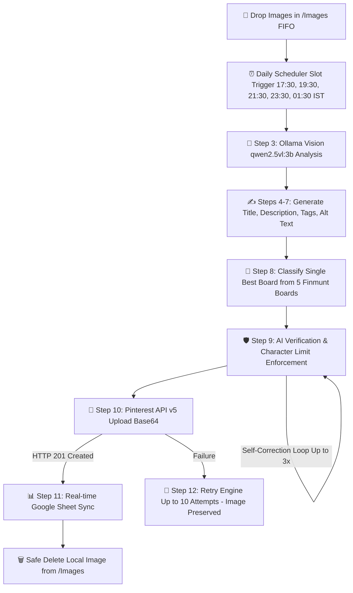

<div align="center">

  

  # 📌 Finmunt • Autonomous Pinterest Publishing Engine
  
  **Self-hosted, 100% automated Pinterest publishing machine powered by local Multimodal AI (`Qwen2.5-VL`), 12-step verified pipeline, and real-time Google Sheets sync.**

  <p align="center">
    <a href="#-architecture--pipeline"><strong>Explore Pipeline »</strong></a> ·
    <a href="#-features"><strong>Features »</strong></a> ·
    <a href="#-quick-start"><strong>Quick Start »</strong></a> ·
    <a href="#-boards-configuration"><strong>Boards Setup »</strong></a>
  </p>

  <p align="center">
    
    
    
    
    
  </p>

  

</div>

---

## ⚡ Highlights

- 🧠 **Local Multimodal AI (`qwen2.5vl:3b`)**: Zero cloud AI fees. Analyzes raw images directly on your machine.
- 🎯 **Intelligent 5-Board Categorizer**: Classifies incoming pins into the exact best board based on content intent.
- 🛡️ **Self-Correcting AI Verifier (Step 9)**: Audits every title ($\le 100$), description ($\le 500$), and alt text ($\le 500$) with automatic rewrite loops before publishing.
- ⏰ **5 Fixed Daily Slots**: Automatically publishes at `17:30`, `19:30`, `21:30`, `23:30`, and `01:30` IST *(8:00 AM, 10:00 AM, 12:00 PM, 2:00 PM, 4:00 PM ET)*.
- 📊 **Real-Time Google Sheets Webhook**: Live 10-column spreadsheet sync for every single attempt & success.
- 🔒 **Safe FIFO Clean-up**: Local images are deleted **only** after Pinterest returns `HTTP 201 Created`. Never lost on error.
- 🎨 **Official Pinterest-Aesthetic Dashboard**: Real-time 7-calendar-day visual activity log with SSE live streams.

---

## 🏗️ Architecture & Pipeline




---

## 📊 Configured Finmunt Boards

The engine is pre-configured with the 5 official Finmunt boards:

| # | Board Name | Pinterest Board ID | Category Focus |
|---|:---|:---|:---|
| 1 | **Make Money** | `1152640167071860781` | Side hustles, online income, freelancing, digital products, monetization |
| 2 | **Save Money** | `1152640167071860782` | Frugal living, cutting expenses, smart savings hacks, deals |
| 3 | **Budgeting** | `1152640167071860784` | Monthly budget planners, 50/30/20 rule, cash envelopes, expense tracking |
| 4 | **Investing** | `1152640167071860785` | Index funds, ETFs, dividend stocks, real estate, compound growth |
| 5 | **Debt & Credit** | `1152640167071860786` | Credit score hacks, debt snowball/avalanche, financial freedom |

---

## 📋 Google Spreadsheet Schema (`Finmunt`)

Every publish automatically appends a structured 10-column record to Google Sheets:

| Col 1 | Col 2 | Col 3 | Col 4 | Col 5 | Col 6 | Col 7 | Col 8 | Col 9 | Col 10 |
|:---:|:---:|:---:|:---:|:---:|:---:|:---:|:---:|:---:|:---:|
| **Date** | **Post Name** | **Time** | **Tries** | **Title** | **Description** | **Alt Text** | **Board** | **Board Id** | **Status** |
| `YYYY-MM-DD` | `image.png` | `HH:mm:ss` | `1` | Max 100 chars | Max 500 chars | Max 500 chars | Board Name | Official ID | `SUCCESS` |

---

## 📁 Repository Structure

```text
Pinterest/
├── Images/              # 📥 Drop Zone: Drop images here (automation detects them)
│   └── README.md        # Pipeline instructions & format guide
├── github/              # 🌐 Neo-Brutalist Landing Page & GitHub Pages assets
│   ├── assets/          # Project logo & favicon assets
│   ├── index.html       # Landing page portal
│   ├── style.css        # Neo-brutalist design system
│   └── script.js        # Direct ZIP download & interactions
├── code/                # 💻 All automation engine code & dependencies
│   ├── .env.example     # 🔑 Public environment template (zero secrets)
│   ├── package.json     # 📦 Dependencies & start scripts
│   └── backend/         # ⚙️ Headless Engine, Ollama AI & Supabase Cloud Sync
│       ├── services/    # Vision AI, Scheduler, Pinterest API, Metadata Stripper & Supabase
│       ├── supabase/    # Cloud Edge Functions, SQL schemas & pg_cron migrations
│       ├── boards.json  # 5 Configured Pinterest boards
│       ├── config.js    # Centralized limits & environment configuration
│       └── server.js    # Express automation service entry point
├── LICENSE              # ⚖️ MIT License
└── README.md            # 📖 Documentation & setup guide
```

---

## 🚀 Quick Start

### 1. Prerequisites
- [Node.js](https://nodejs.org/) (v18 or higher)
- [Ollama](https://ollama.com/) with vision model installed:
  ```bash
  ollama pull qwen2.5vl:3b
  ```

### 2. Setup & Run
Navigate into the `code/` folder:
```bash
cd code
npm install
npm start
```

### 3. How to Publish Pins
Simply drop your images (`.png`, `.jpg`, `.webp`) into the `Images/` folder.
- The engine automatically strips all AI metadata tags.
- Ollama Vision analyzes the image and crafts high-converting titles, descriptions, and tags.
- Pins are synced directly into Supabase Storage & `pin_queue`.
- 24/7 cloud cron triggers publish your pins across your 5 daily slots automatically!

### 4. Push Secrets to Supabase Cloud (24/7 Publishing)
To allow Supabase Edge Functions and cron jobs to publish when your computer is off:
```bash
# Method A: One-command push from .env file
npx supabase login
npx supabase link --project-ref your_project_ref_id
npx supabase secrets set --env-file code/.env

# Or Method B: In Supabase Web Dashboard
# Project Settings -> Edge Functions -> Secrets -> Add PINTEREST_ACCESS_TOKEN & APP_SECRET
```

---

## 💬 Connect & Support

- 🌐 **Contact Faruk**: [witrfaruk.vercel.app/social](https://witrfaruk.vercel.app/social)
- ☕ **Support on Ko-fi**: [ko-fi.com/witrfaruk](https://ko-fi.com/witrfaruk)
- ⚖️ **License**: MIT License

---

<div align="center">
  <sub>Built with ❤️ by <strong><a href="https://witrfaruk.vercel.app/social">Faruk</a></strong> • Engineered for 100% Autonomous Content Delivery</sub>
</div>

