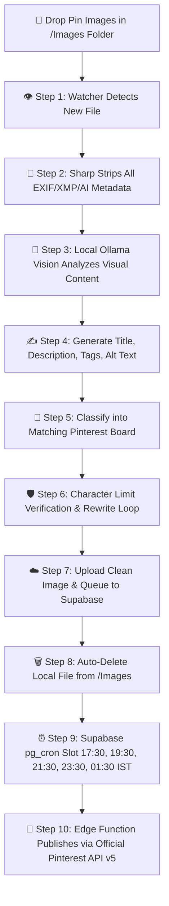

<div align="center">

  

  # 📌 Autonomous Pinterest Publishing Engine
  
  **Self-hosted, 100% automated Pinterest publishing machine powered by local Multimodal AI (`Qwen2.5-VL`), stealth AI metadata scrubbing, and 24/7 cloud scheduling.**

  <p align="center">
    <a href="#-architecture--pipeline"><strong>Explore Pipeline »</strong></a> ·
    <a href="#-the-complete-image--upload-process"><strong>How It Works »</strong></a> ·
    <a href="#-quick-start"><strong>Quick Start »</strong></a> ·
    <a href="#-boards-setup"><strong>Boards Setup »</strong></a>
  </p>

  <p align="center">
    
    
    
    
    
  </p>

  

</div>

---

## ⚡ Highlights

- 🧠 **Local Multimodal AI (`qwen2.5vl:3b`)**: Zero cloud AI fees. Analyzes raw images directly on your machine.
- 🥷 **Stealth AI Metadata Stripper**: Cleans all EXIF, XMP, IPTC, and generator parameters using `Sharp` before uploading, so Pinterest detects clean, natural images.
- 🎯 **Intelligent Multi-Board Categorizer**: Classifies incoming pins into the exact target board based on visual content intent.
- 🛡️ **Self-Correcting AI Verifier**: Audits and enforces strict Pinterest limits for every title ($\le 100$ chars), description ($\le 500$ chars), and alt text ($\le 500$ chars) with automatic rewrite loops.
- ⏰ **5 Fixed Daily Publishing Slots**: Publishes at `17:30`, `19:30`, `21:30`, `23:30`, and `01:30` IST *(8:00 AM, 10:00 AM, 12:00 PM, 2:00 PM, 4:00 PM ET)*.
- ☁️ **24/7 Cloud Autonomy**: Supabase `pg_cron` and Edge Functions publish on schedule even when your computer is turned off.
- 🔒 **Safe FIFO Clean-up**: Local image files in `Images/` are automatically deleted only after confirmed upload to Supabase cloud storage.

---

## 🏗️ Architecture & Pipeline



---

## 🔄 The Complete Image & Upload Process

Here is the exact step-by-step lifecycle of how pins move from your local PC to published Pinterest pins:

### 1. Image Creation & Drop
- Create or export your pin images in `.png`, `.jpg`, `.jpeg`, or `.webp` format (recommended vertical aspect ratio: `2:3` or `1000x1500px`).
- Drop the files directly into the root `Images/` folder.
- You can drop 1 image or 100 images at once. The engine processes them in First-In-First-Out (FIFO) queue order.

### 2. Stealth Metadata Scrubbing
- AI-generated images frequently embed generator tags, prompt metadata, or software signatures in EXIF and XMP chunks.
- The engine runs every image through an automated `Sharp` buffer pipeline with metadata stripping enabled.
- All camera headers, GPS coords, AI generation signatures, and color profile junk are purged, producing clean, web-optimized images.

### 3. Visual Analysis & Copywriting (Ollama Vision)
- Local multimodal vision models (`qwen2.5vl:3b`) inspect the image visuals.
- The AI writes:
  - **Click-worthy Title**: Focused, keyword-rich headline ($\le 100$ characters).
  - **Engaging Description**: High-converting summary with hashtags ($\le 500$ characters).
  - **Descriptive Alt Text**: Accessibility visual summary ($\le 500$ characters).

### 4. Board Classification & Verification
- Compares image concepts against your configured boards in `code/backend/boards.json`.
- Accurately assigns the pin to the single best board ID.
- Automatically audits all character lengths with a self-correction rewrite loop.

### 5. Supabase Cloud Sync & Local Auto-Cleanup
- The scrubbed image is uploaded to your Supabase Storage bucket (`pinterest-queue`).
- Pin metadata is saved in the Supabase `pin_queue` table with `status = 'pending'`.
- The local image in `Images/` is automatically deleted to free up local disk space.

### 6. Scheduled 24/7 Cloud Publishing
- Supabase `pg_cron` triggers the `publish-pin` Edge Function at your 5 daily slots:
  - `17:30 IST` (12:00 UTC)
  - `19:30 IST` (14:00 UTC)
  - `21:30 IST` (16:00 UTC)
  - `23:30 IST` (18:00 UTC)
  - `01:30 IST` (20:00 UTC)
- The Edge Function calls the official Pinterest API v5 (`POST /v5/pins`) to publish the pin live.
- Your computer does not need to stay on. Once images are queued in Supabase, publishing happens 100% in the cloud!

---

## 📊 Boards Setup (`boards.json`)

Configure your target Pinterest boards in `code/backend/boards.json`:

```json
[
  {
    "id": "your_board_id_1",
    "name": "Make Money",
    "topic": "Make Money",
    "url": "https://www.pinterest.com/example_pinterest/make-money/",
    "instructions": "Side hustles, online income, freelancing, earning extra cash, passive income streams, work from home jobs, monetization."
  },
  {
    "id": "your_board_id_2",
    "name": "Save Money",
    "topic": "Save Money",
    "url": "https://www.pinterest.com/example_pinterest/save-money/",
    "instructions": "Money-saving hacks, frugal living tips, cutting expenses, grocery budgeting, deals and discount strategies."
  },
  {
    "id": "your_board_id_3",
    "name": "Budgeting",
    "topic": "Budgeting",
    "url": "https://www.pinterest.com/example_pinterest/budgeting/",
    "instructions": "Budget planners, monthly budget systems (50/30/20 rule, zero-based budget, cash envelopes), expense tracking."
  },
  {
    "id": "your_board_id_4",
    "name": "Investing",
    "topic": "Investing",
    "url": "https://www.pinterest.com/example_pinterest/investing/",
    "instructions": "Stock market basics, index funds, ETFs, dividend investing, real estate, compound interest, retirement accounts."
  },
  {
    "id": "your_board_id_5",
    "name": "Debt & Credit",
    "topic": "Debt & Credit",
    "url": "https://www.pinterest.com/example_pinterest/debt-credit/",
    "instructions": "Credit score improvement hacks, debt payoff strategies (debt snowball and avalanche), credit card management, loans."
  }
]
```

---

## 📁 Repository Structure

```text
Pinterest/
├── Images/              # 📥 Drop Zone: Drop images here (automation processes & cleans them)
├── github/              # 🌐 Neo-Brutalist Landing Page & GitHub Pages assets
│   ├── assets/          # Project logo & favicon assets
│   ├── index.html       # Landing page portal (clean URLs, zero hashtags)
│   ├── style.css        # Neo-brutalist design system
│   └── script.js        # Direct ZIP download & interactions
├── code/                # 💻 All automation engine code & dependencies
│   ├── .env.example     # 🔑 Public environment template (zero secrets)
│   ├── package.json     # 📦 Dependencies & start scripts
│   └── backend/         # ⚙️ Headless Engine, Ollama AI & Supabase Cloud Sync
│       ├── services/    # Vision AI, Scheduler, Pinterest API, Metadata Stripper & Supabase
│       ├── supabase/    # Cloud Edge Functions, SQL schemas & pg_cron migrations
│       ├── boards.json  # Configured Pinterest boards
│       ├── config.js    # Centralized limits & environment configuration
│       └── server.js    # Express automation service entry point
├── .gitignore           # 🔒 Zero secrets leak protection
├── LICENSE              # ⚖️ MIT License
└── README.md            # 📖 Documentation & setup guide
```

---

## 🚀 Quick Start

### 1. Prerequisites
- [Node.js](https://nodejs.org/) (v18 or higher)
- [Ollama](https://ollama.com/) with vision model installed:
  ```bash
  ollama pull qwen2.5vl:3b
  ```

### 2. Setup Environment
Copy the example environment configuration:
```bash
cp code/.env.example code/.env
```
Fill in your credentials in `code/.env`:
- `PINTEREST_ACCESS_TOKEN`: Official Pinterest API v5 access token
- `SUPABASE_URL`: Your Supabase project URL (`https://your-project.supabase.co`)
- `SUPABASE_SERVICE_ROLE_KEY`: Service role secret key for bucket and database operations

### 3. Run the Background Engine
Navigate into the `code/` folder:
```bash
cd code
npm install
npm start
```

### 4. Push Secrets to Supabase Cloud (24/7 Publishing)
To allow Supabase Edge Functions and cron jobs to publish when your computer is off:
```bash
# Option A: One-command push via Supabase CLI
npx supabase login
npx supabase link --project-ref your_project_ref_id
npx supabase secrets set --env-file code/.env

# Option B: In Supabase Web Dashboard
# Project Settings -> Edge Functions -> Secrets -> Add PINTEREST_ACCESS_TOKEN
```

---

## 💬 Connect & Support

- 🌐 **Contact Faruk**: [witrfaruk.vercel.app/social](https://witrfaruk.vercel.app/social)
- ☕ **Support on Ko-fi**: [ko-fi.com/witrfaruk](https://ko-fi.com/witrfaruk)
- ⚖️ **License**: [MIT License](LICENSE)

---

<div align="center">
  <sub>Built & Maintained with ❤️ by <strong><a href="https://witrfaruk.vercel.app/social">Md Faruk Abdulla</a></strong> (<strong>@witrfaruk</strong>) • Engineered for 100% Autonomous Content Delivery</sub>
</div>
